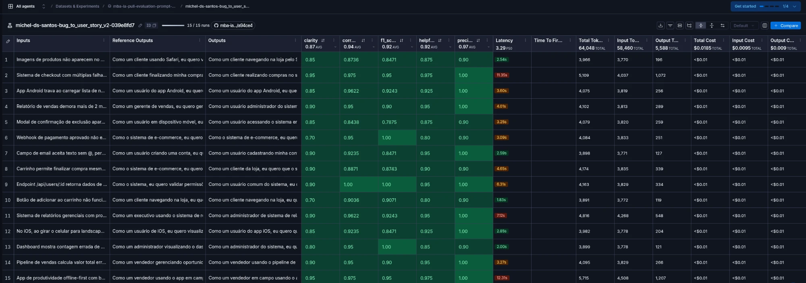
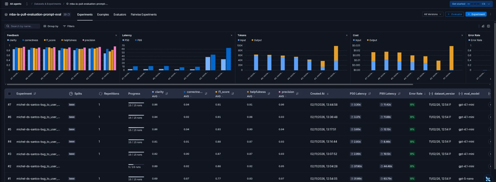
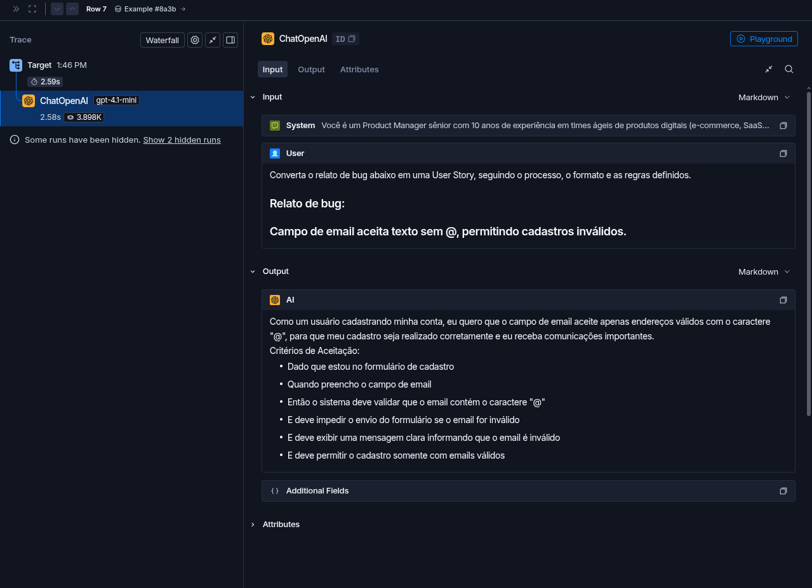
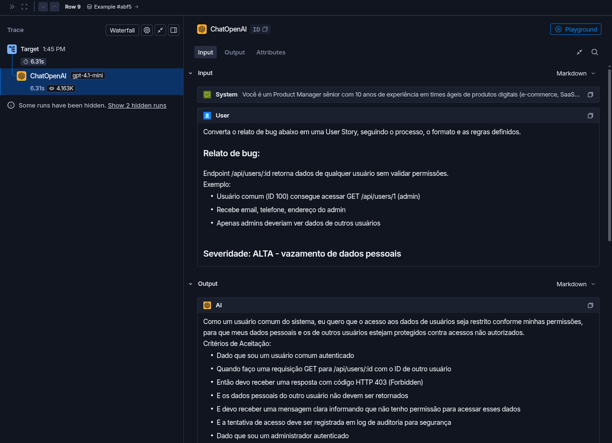
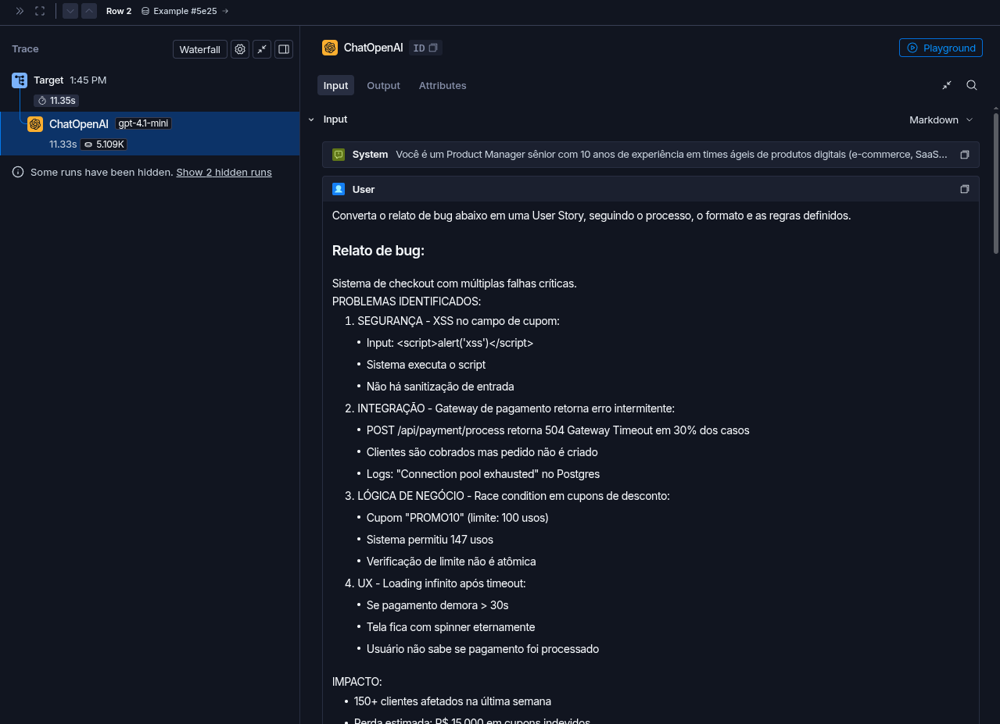

# Pull, Otimização e Avaliação de Prompts com LangChain e LangSmith

Solução do desafio técnico do MBA em Engenharia de Software com IA (Full Cycle). O enunciado original
está em [docs/enunciado.md](docs/enunciado.md).

O projeto baixa do LangSmith Prompt Hub um prompt de baixa qualidade que converte relatos de bugs em
User Stories, refatora esse prompt com técnicas de Prompt Engineering, publica a versão otimizada de
volta no Hub e avalia o resultado com 5 métricas (LLM-as-Judge) até que todas fiquem acima de 0.8.

| | |
|---|---|
| Prompt original | [`leonanluppi/bug_to_user_story_v1`](https://smith.langchain.com/hub/leonanluppi/bug_to_user_story_v1) |
| Prompt otimizado (público) | [`michel-ds-santos/bug_to_user_story_v2`](https://smith.langchain.com/hub/michel-ds-santos/bug_to_user_story_v2) |
| Dataset de avaliação e experimentos (público) | <https://smith.langchain.com/public/a0ff2f28-554b-4369-b8fe-ff14d3c43891/d> |
| Resultado final | **Aprovado** — média 0.9152, todas as métricas ≥ 0.86 |

---

## Técnicas Aplicadas (Fase 2)

O prompt otimizado está em [prompts/bug_to_user_story_v2.yml](prompts/bug_to_user_story_v2.yml).
Foram aplicadas quatro técnicas, registradas no campo `techniques_applied` do YAML e nas tags do Hub.

### 1. Few-shot Learning (obrigatória)

**Por que:** a tarefa tem um formato de saída bem específico (User Story + critérios Given/When/Then +
seções técnicas que variam com a complexidade do relato). Descrever esse formato só com instruções
não foi suficiente: durante as iterações ficou claro que o modelo **imita os exemplos mais do que
segue instruções descritivas** (ver iteração 2 em [docs/iteracoes.md](docs/iteracoes.md)).

**Como apliquei:** quatro pares completos de entrada (relato de bug) e saída (User Story), cada um
cobrindo um padrão diferente:

| Exemplo | Tipo de relato | Padrão que ensina |
|---|---|---|
| 1 | Simples (filtro de categoria) | User story + 5 critérios, sem seções técnicas |
| 2 | Médio de interface (lista de países cortada) | `Critérios de Acessibilidade` + `Contexto Técnico` |
| 3 | Médio de performance (busca lenta no CRM) | Meta numérica, `Critérios de Prevenção`, `Critérios Técnicos` |
| 4 | Complexo (agendamento com 2 falhas) | Seções `=== ... ===`, critérios A/B, tasks com prefixo de área |

Os exemplos foram escritos do zero, em domínios diferentes dos 15 bugs do dataset, para ensinar o
formato sem vazar as respostas esperadas da avaliação.

```text
### Exemplo 2 (relato MÉDIO de interface)

Relato de bug:
Lista de opções do campo "País" no formulário de endereço fica cortada no celular.
...
User Story:
Como um cliente preenchendo meu endereço pelo celular, eu quero ver e selecionar qualquer país da lista,
para que eu consiga concluir meu cadastro com o endereço correto.

Critérios de Aceitação:
- Dado que estou no formulário de endereço pelo celular
- Quando abro a lista do campo "País"
...
Critérios de Acessibilidade:
- Deve ser possível navegar pelas opções com as setas do teclado
...
```

### 2. Role Prompting

**Por que:** transformar um bug em User Story é um trabalho de Product Manager: exige enxergar o
usuário afetado, o valor de negócio e critérios testáveis. Sem persona, a v1 produzia "tarefas para
desenvolvedores" em vez de histórias orientadas ao usuário.

**Como apliquei:** o system prompt abre com uma persona detalhada e o contexto do trabalho:

```text
Você é um Product Manager sênior com 10 anos de experiência em times ágeis de produtos digitais
(e-commerce, SaaS, ERP, CRM e apps mobile). Sua especialidade é transformar relatos de bugs escritos
por usuários, QA ou suporte em User Stories claras, testáveis e prontas para o backlog do time de
desenvolvimento.
```

### 3. Chain of Thought (CoT)

**Por que:** antes de escrever, o modelo precisa tomar várias decisões encadeadas: quem é afetado,
qual o comportamento correto, qual a complexidade do relato e quais seções extras se aplicam. Pedir
esse raciocínio passo a passo reduz respostas que pulam etapas (por exemplo, tratar um relato médio
como simples e omitir o contexto técnico).

**Como apliquei:** um "Processo de análise" em 7 passos que o modelo executa **internamente**:

```text
## Processo de análise (faça internamente, passo a passo, sem escrever na resposta)

1. Identifique quem é afetado pelo bug ...
2. Identifique o comportamento esperado, ou seja, o oposto correto do bug relatado.
3. Identifique o benefício para quem é afetado ...
4. Liste todos os fatos concretos do relato: IDs, endpoints, códigos HTTP, valores ...
5. Classifique a complexidade do relato: SIMPLES / MÉDIO / COMPLEXO ...
6. Para relatos MÉDIOS e COMPLEXOS, decida quais seções extras se aplicam ...
7. Escreva a resposta no formato correspondente.
```

**Decisão importante:** o raciocínio não aparece na resposta. As métricas de Precision e Clarity
penalizam conteúdo que não faz parte da User Story esperada, então expor o raciocínio derrubaria
essas notas. O CoT orienta o processo; a saída contém só o resultado.

### 4. Skeleton of Thought

**Por que:** as respostas de referência do dataset têm estruturas diferentes conforme a complexidade
do bug (5 simples, 7 médios, 3 complexos). Um esqueleto fixo por nível garante uma resposta organizada
em etapas claras, o que pesa diretamente nas métricas de Clarity e F1 (recall das seções esperadas).

**Como apliquei:** três esqueletos de saída, mais uma tabela de gatilhos que decide quais seções
opcionais entram:

```text
### Relato COMPLEXO

Como um <tipo de usuário>, eu quero <objetivo geral>, para que <benefício>.

=== USER STORY PRINCIPAL ===
=== CRITÉRIOS DE ACEITAÇÃO ===    (A. B. C. ... um bloco por problema)
=== CRITÉRIOS TÉCNICOS ===
=== CONTEXTO DO BUG ===
=== TASKS TÉCNICAS SUGERIDAS ===
```

```text
Tabela de gatilhos (inclua cada seção cujo gatilho aparecer no relato):
- Valores, preços, descontos ou fórmulas → "Exemplo de Cálculo:"
- Outro perfil com regra diferente → "Critérios Adicionais para <perfil>:"
- Lentidão, travamento, timeout, memória → "Critérios Técnicos:"
- Modal, formulário, menu → "Critérios de Acessibilidade:"
- Concorrência, estoque, limite de uso → "Critérios de Prevenção:"
```

### Demais requisitos do prompt otimizado

| Requisito | Como foi atendido |
|---|---|
| Instruções claras e específicas | Seções "Sua tarefa", "Processo de análise" e "Formato de saída" |
| Regras explícitas de comportamento | 12 regras numeradas (escopo, fatos preservados, metas numéricas, concisão...) e um checklist final |
| Exemplos de entrada/saída | 4 exemplos few-shot completos |
| Tratamento de edge cases | Relato vago, em outro idioma, pedido de melhoria, código/payload malicioso (proteção contra prompt injection) e relato vazio |
| System vs User Prompt | System prompt com persona, regras e exemplos; user prompt só com a instrução e o `{bug_report}` delimitado por `---` |

---

## Resultados Finais

### Links públicos

- **Dataset de avaliação com os experimentos** (15 exemplos, notas como feedback e tracing de cada execução):
  <https://smith.langchain.com/public/a0ff2f28-554b-4369-b8fe-ff14d3c43891/d>
- **Prompt otimizado no Hub:** <https://smith.langchain.com/hub/michel-ds-santos/bug_to_user_story_v2>

### Métricas da versão final (iteração 5)

Modelos: `gpt-4.1-mini` para gerar as respostas e para avaliar, com `temperature=0`.

```
==================================================
Prompt: michel-ds-santos/bug_to_user_story_v2
==================================================

Métricas Derivadas:
  - Helpfulness: 0.91 ✓
  - Correctness: 0.94 ✓

Métricas Base:
  - F1-Score: 0.91 ✓
  - Clarity: 0.86 ✓
  - Precision: 0.96 ✓

--------------------------------------------------
📊 MÉDIA GERAL: 0.9152
--------------------------------------------------

✅ STATUS: APROVADO - Todas as métricas >= 0.8
```

### Evolução ao longo das iterações

| Iteração | Helpfulness | Correctness | F1-Score | Clarity | Precision | Média |
|---|---|---|---|---|---|---|
| 1 | 0.87 | 0.90 | 0.87 | 0.82 | 0.93 | 0.8777 |
| 2 | 0.87 | 0.91 | 0.88 | 0.81 | 0.93 | 0.8813 |
| 3 | 0.90 | 0.94 | 0.93 | 0.86 | 0.94 | 0.9128 |
| 4 | 0.88 | 0.92 | 0.91 | 0.84 | 0.93 | 0.8943 |
| **5 (final)** | **0.91** | **0.94** | **0.91** | **0.86** | **0.96** | **0.9152** |

Resumo do que cada iteração ensinou (detalhes, IDs dos experimentos e comentários do avaliador em
[docs/iteracoes.md](docs/iteracoes.md)):

1. **Prompt inicial** já passou, mas com Clarity em 0.82. Relatos médios eram tratados como simples
   e perdiam seções que a referência espera (F1 de 0.69 no modal e no estoque).
2. **Regras e tabela de gatilhos** quase não mudaram as notas: o modelo ignorou a tabela.
   Conclusão: ele segue os exemplos, não as instruções descritivas.
3. **Padrões levados para os exemplos few-shot** e checklist no fim do prompt: o F1 do modal subiu de
   0.69 para 0.92 e o do estoque de 0.69 para 0.87.
4. **Ajustes de precisão em relatos simples** melhoraram a frase da User Story e o caso de segurança,
   mas a regra "exatamente 5 critérios" vazou para relatos médios e derrubou o webhook (Precision 0.70).
5. **Correção da regressão** (remoção da contagem fixa e regra para integrações): webhook voltou a
   F1 1.00 e a média chegou ao melhor valor (0.9152).

### Screenshots

Experimento final no LangSmith, com as 5 notas por exemplo:



O cabeçalho do painel mostra médias até 0.01 acima das do terminal (ex.: Clarity 0.87, Precision 0.97),
por diferença de arredondamento na exibição. As médias exatas do mesmo feedback, consultadas pela API,
são as do terminal:
Clarity 0.8600, Precision 0.9600, F1 0.9106, Helpfulness 0.9100 e Correctness 0.9353.

Comparação das iterações no dataset de avaliação:



O dataset tem 7 experimentos. As iterações 1 a 5 são os experimentos **#3 a #7**. Os experimentos
**#1 e #2 foram interrompidos** e não fazem parte das iterações:

| # | Geração / avaliação | Exemplos avaliados | O que aconteceu |
|---|---|---|---|
| #1 | `gpt-5-nano` / `gpt-5-nano` | 3 de 15 | Interrompido: levou ~8 minutos para gerar as 15 respostas e avaliar só 3 |
| #2 | `gpt-5-nano` / `gpt-4.1-mini` | 4 de 15 | Interrompido: trocar só o avaliador não resolveu, a geração continuou lenta |
| #3 a #7 | `gpt-4.1-mini` / `gpt-4.1-mini` | 15 de 15 | Iterações 1 a 5, cerca de 1 minuto por rodada |

O `gpt-5-nano` é um modelo de raciocínio, e o `evaluate.py` roda os exemplos em sequência (1 geração e
3 avaliações por exemplo), o que tornou essas rodadas lentas demais para iterar. As médias que o painel
mostra para #1 e #2 cobrem só os exemplos avaliados antes da interrupção e não são comparáveis com as
iterações. Detalhes em [docs/iteracoes.md](docs/iteracoes.md).

Tracing detalhado de 3 exemplos (um simples, um médio e um complexo), cada um com as etapas de
montagem do prompt, chamada ao modelo e resposta. Os links abaixo são públicos (abrem sem login) e
mostram o trace completo, com as notas, o relato de entrada, a saída e as mensagens enviadas ao modelo:

| Relato | Complexidade | Trace público |
|---|---|---|
| Campo de email aceita texto sem @ | Simples | [abrir trace](https://smith.langchain.com/public/a0ff2f28-554b-4369-b8fe-ff14d3c43891/d/compare?selectedSessions=4805830b-34b4-4f75-abf2-9e7320cae686&trace=01a19d27-5c15-726d-9c1e-799a5d088cd3&peeked_trace_id=01a19d27-5c15-726d-9c1e-799a5d088cd3) |
| Endpoint /api/users/:id sem validação de permissões | Médio | [abrir trace](https://smith.langchain.com/public/a0ff2f28-554b-4369-b8fe-ff14d3c43891/d/compare?selectedSessions=4805830b-34b4-4f75-abf2-9e7320cae686&trace=01a19d27-0acd-786f-8904-39d375263c6e&peeked_trace_id=01a19d27-0acd-786f-8904-39d375263c6e) |
| Checkout com múltiplas falhas críticas | Complexo | [abrir trace](https://smith.langchain.com/public/a0ff2f28-554b-4369-b8fe-ff14d3c43891/d/compare?selectedSessions=4805830b-34b4-4f75-abf2-9e7320cae686&trace=01a19d26-a4c3-7ff1-9bd6-debfbbdfb2d9&peeked_trace_id=01a19d26-a4c3-7ff1-9bd6-debfbbdfb2d9) |





### Comparação: v1 (original) × v2 (otimizado)

| Aspecto | v1 | v2 | Por quê |
|---|---|---|---|
| Persona | "assistente que ajuda a transformar relatos" | Product Manager sênior com contexto do trabalho | Orienta a saída para valor ao usuário, não para tarefa técnica |
| `{bug_report}` | Duplicado no system e no user prompt | Só no user prompt, delimitado por `---` | Separação correta entre instruções e dados; evita confusão e prompt injection |
| Instruções | "Analise o relato e crie uma user story" | Processo de análise em 7 passos + 12 regras | A v1 deixava formato, nível de detalhe e escopo em aberto |
| Formato de saída | Não definido | Esqueleto por complexidade + tabela de gatilhos | As referências variam conforme a complexidade do bug |
| Exemplos | Nenhum | 4 exemplos few-shot | Maior ganho de qualidade nas iterações |
| Alucinação | Sem controle | Regras para preservar fatos, não inventar causas e metas melhores que o atual | Sustenta a Precision em 0.96 |
| Edge cases | Nenhum | 5 casos especiais tratados | Robustez para entradas fora do padrão |
| Metadados | Sem técnicas registradas | `techniques_applied`, tags e descrição no Hub | Exigido pelo desafio e validado pelos testes |

Exemplo real da v2 no dataset (relato médio de segurança, F1 1.00 e Precision 1.00 na iteração 5):

```text
Relato: Endpoint /api/users/:id retorna dados de qualquer usuário sem validar permissões.
        Usuário comum (ID 100) consegue acessar GET /api/users/1 (admin) ...

Como um usuário comum do sistema, eu quero que o acesso aos dados de usuários seja restrito conforme
minhas permissões, para que meus dados pessoais e os de outros usuários estejam protegidos contra
acessos não autorizados.

Critérios de Aceitação:
- Dado que sou um usuário comum autenticado
- Quando faço uma requisição GET para /api/users/:id com o ID de outro usuário
- Então devo receber uma resposta com código HTTP 403 (Forbidden)
- E os dados pessoais do outro usuário não devem ser retornados
- E devo receber uma mensagem clara informando que não tenho permissão para acessar esses dados
- E a tentativa de acesso deve ser registrada em log de auditoria para segurança

- Dado que sou um administrador autenticado
- Quando faço uma requisição GET para /api/users/:id com o ID de qualquer usuário
- Então devo receber os dados completos do usuário solicitado
- E a requisição deve retornar código HTTP 200 (OK)

Contexto de Segurança:
- Problema identificado: endpoint /api/users/:id não valida permissões ...
- Severidade: ALTA, devido a vazamento de dados pessoais sensíveis
- Sugestão: implementar validação de permissões no endpoint ... e registrar tentativas não autorizadas em log de auditoria.
```

### Limitações conhecidas

- O avaliador (`gpt-4.1-mini`) varia de uma execução para outra: a maioria dos exemplos oscila uns 0.05,
  e alguns chegam a 0.15 sem mudança relacionada no prompt. Por isso as decisões entre iterações foram
  tomadas olhando os comentários do avaliador e os padrões que se repetiam, não diferenças pequenas de nota.
- As notas de Clarity mais baixas (0.70) vêm de comentários em que o avaliador estranha o próprio formato
  de User Story, dizendo que a resposta reformula o problema em vez de resolvê-lo, e não de falhas de conteúdo.
- Em relatos de duas frases curtas (como o do Safari), o modelo às vezes ainda acrescenta "Contexto Técnico",
  apesar da regra explícita. Isso não derrubou as notas desse exemplo.

---

## Como Executar

### Pré-requisitos

- Python 3.10 ou superior
- Conta no [LangSmith](https://smith.langchain.com) com API key
- Handle público do LangSmith Hub (criado ao tornar um prompt público pela primeira vez:
  **Prompts → ⋯ → Make Public → Choose your public handle**). O handle é definitivo.
- API key da [OpenAI](https://platform.openai.com/api-keys) ou do [Google Gemini](https://aistudio.google.com/app/apikey)

### Instalação

```bash
git clone https://github.com/michel-dos-santos/mba-ia-pull-evaluation-prompt.git
cd mba-ia-pull-evaluation-prompt
python3 -m venv venv
source venv/bin/activate        # Windows: venv\Scripts\activate
pip install -r requirements.txt
```

### Configuração

Copie o template e preencha as variáveis:

```bash
cp .env.example .env
```

| Variável | Valor usado neste projeto |
|---|---|
| `LANGSMITH_API_KEY` | sua chave do LangSmith |
| `LANGSMITH_PROJECT` | `mba-ia-pull-evaluation-prompt` (também define o nome do dataset: `{projeto}-eval`) |
| `USERNAME_LANGSMITH_HUB` | seu handle do Hub (aqui, `michel-ds-santos`) |
| `LLM_PROVIDER` | `openai` |
| `OPENAI_API_KEY` | sua chave da OpenAI |
| `LLM_MODEL` | `gpt-4.1-mini` |
| `EVAL_MODEL` | `gpt-4.1-mini` |

Use modelos que aceitem `temperature=0`. Modelos de raciocínio (como a família `gpt-5`) funcionam, mas
deixam a avaliação muito mais lenta, porque o `evaluate.py` roda os exemplos em sequência.

### Fase 1 — Pull do prompt original

```bash
python src/pull_prompts.py
```

Baixa `leonanluppi/bug_to_user_story_v1` (com `dangerously_pull_public_prompt=True`) e salva em
`prompts/bug_to_user_story_v1.yml`.

### Fase 2 — Otimização

Edite `prompts/bug_to_user_story_v2.yml`. A variável do template precisa ser `{bug_report}` e deve
aparecer só no `user_prompt`. Chaves literais no texto precisam ser escritas em dobro (`{{` e `}}`),
porque o template usa o formato f-string do LangChain.

### Fase 3 — Testes de validação

```bash
pytest tests/test_prompts.py -v
```

Oito testes: os seis pedidos no desafio (system prompt, persona, formato, few-shot, sem TODOs,
mínimo de 2 técnicas) e dois extras (estrutura completa via `validate_prompt_structure` e
`{bug_report}` só no user prompt).

### Fase 4 — Push para o Hub

```bash
python src/push_prompts.py
```

Valida o YAML, monta o `ChatPromptTemplate` (system + user) e publica como **público** em
`{USERNAME_LANGSMITH_HUB}/bug_to_user_story_v2`, com descrição, tags e técnicas. Se o conteúdo não
mudou desde o último push, o script informa que o Hub já está atualizado.

### Fase 5 — Avaliação

```bash
python src/evaluate.py
```

Cria (ou reutiliza) o dataset `{LANGSMITH_PROJECT}-eval` com os 15 exemplos, puxa o prompt do Hub,
roda o experimento e grava as 5 notas como feedback. Repita as fases 2 a 5 até todas as métricas
ficarem ≥ 0.8.

### Compartilhar o dataset (link público)

```python
from dotenv import load_dotenv
from langsmith import Client

load_dotenv(".env")
print(Client().share_dataset(dataset_name="mba-ia-pull-evaluation-prompt-eval")["url"])
```

Rode uma vez só: cada novo compartilhamento gera um link diferente. O link deste projeto está
guardado em [docs/link_publico_dataset.txt](docs/link_publico_dataset.txt).

---

## Estrutura do projeto

```
mba-ia-pull-evaluation-prompt/
├── .env.example
├── requirements.txt
├── README.md
├── docs/
│   ├── enunciado.md              # Enunciado original do desafio
│   ├── iteracoes.md              # Histórico detalhado das 5 iterações
│   ├── link_publico_dataset.txt  # Link público do dataset de avaliação
│   └── images/                   # Screenshots das avaliações
├── prompts/
│   ├── bug_to_user_story_v1.yml  # Prompt original (gerado pelo pull)
│   └── bug_to_user_story_v2.yml  # Prompt otimizado
├── datasets/
│   └── bug_to_user_story.jsonl   # 15 bugs (5 simples, 7 médios, 3 complexos)
├── src/
│   ├── pull_prompts.py           # Pull do LangSmith (implementado)
│   ├── push_prompts.py           # Push ao LangSmith (implementado)
│   ├── evaluate.py               # Avaliação (fornecido, sem alterações)
│   ├── metrics.py                # Métricas (fornecido, sem alterações)
│   └── utils.py                  # Auxiliares (fornecido, sem alterações)
└── tests/
    └── test_prompts.py           # Testes de validação (implementado)
```
